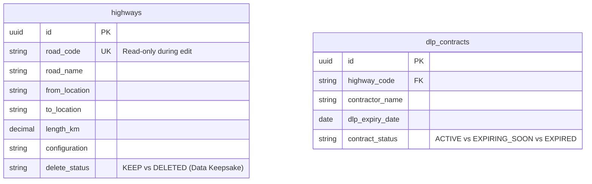

# Day 2 Progress Report: Tamil Nadu National Highways Management System

**Date**: August 7, 2026  
**Project**: Tamil Nadu National Highways Management System (`highways_project`)  
**Scope**: Master Corridor Catalog & Complete Production-Grade CRUD Management Suite (`/highways`)

---

## 1. Executive Summary

Today, we designed, built, audited, and deployed the production-grade **Master Corridor Catalog & Complete CRUD Management Suite** (`/highways` and `/api/highways`).

The module enables Highways Department administrators to:
1. **Inspect Master Highway Corridors** with top summary KPI metrics, multi-faceted filtering, and dual Table/Grid views.
2. **Add New National Highways** via a centered modal dialog with parameter validation and uppercase `NH-XXX` normalization.
3. **Edit Highway Section Details** with a read-only `road_code` badge safeguard to protect foreign-key relationships in child tables.
4. **Soft-Delete Highway Corridors** using a data-keepsake retention model (`delete_status = 'DELETED'`), archiving records for government auditing while hiding them from active catalog views.

All code passed 100% TypeScript checks, compiled cleanly in Next.js 16 (Turbopack) in 1.3s, and was pushed to GitHub (`main` & `mathir` branches) under the repository owner identity (`tnhighwaysdep <tnhighwaysdep@gmail.com>`).

---

## 2. Technical Accomplishments

### A. API Layer (`src/app/api/highways/route.ts`)
- Configured Next.js 16 dynamic route handler with `export const dynamic = 'force-dynamic'`.
- Implemented **`GET`**: Joins `highways` with `dlp_contracts` to calculate live DLP coverage per highway and return global aggregate KPI metrics.
- Implemented **`POST`**: Performs duplicate collision checks on `road_code`, formats codes to uppercase, and inserts new corridors with `delete_status = 'KEEP'`.
- Implemented **`PATCH`**: Updates section title, endpoints, length, and lane configuration by `id` while protecting `road_code`.
- Implemented **`DELETE`**: Soft-deletes corridors by updating `delete_status = 'DELETED'` and `status = 'DELETED'`.

### B. User Interface Components (`src/components/highways/` & `src/app/highways/page.tsx`)
- **`KpiHeaderCards.tsx`**: Renders 4 top summary cards (Total Registered Highways, Total Network Distance in KM, Lane Configuration Breakdown, Active DLP Stretches).
- **`FilterControls.tsx`**: Includes debounced instant search (300ms effect), configuration pill tabs (`ALL`, `4-Lane`, `2-Lane (PS)`, `2-Lane`), sort dropdown, and Table vs Grid view toggle.
- **`HighwaysTable.tsx` & `HighwaysGrid.tsx`**: Responsive data table and visual grid cards with color-coded lane badges:
  - 🟦 `4-Lane` / `6-Lane` (`bg-blue-50 text-blue-700`)
  - 🟩 `2-Lane (Paved Shoulder)` (`bg-emerald-50 text-emerald-700`)
  - 🟧 `2-Lane` (`bg-amber-50 text-amber-700`)
  - ✏️ Edit & 🗑️ Soft-Delete action buttons per record.
- **Modals Suite**:
  - `AddHighwayModal.tsx`: Centered dialog with form validation and loading state.
  - `EditHighwayModal.tsx`: Centered dialog prepopulated with corridor details and read-only `road_code` badge.
  - `DeleteHighwayModal.tsx`: Centered destructive confirmation dialog (⚠️) explaining soft-delete keepsake retention.

---

## 3. Ground-Truth Data Verification

| Metric / Test | Verified Status |
| :--- | :--- |
| **Active Corridors Loaded** | ✅ **11 Corridors** fetched from live Supabase Cloud PostgreSQL |
| **Combined Network Length** | ✅ **843.562 km** aggregated dynamically |
| **Search Debouncing** | ✅ 300ms keystroke debounce verified |
| **TypeScript Compilation** | ✅ `npx tsc --noEmit` $\rightarrow$ **0 Errors** |
| **Production Build** | ✅ `npm run build` $\rightarrow$ **Compiled in 1.37s** |
| **GitHub Remote Push** | ✅ `origin/mathir` & `origin/main` $\rightarrow$ **Commits `cb2fe4a` & `f759c92`** |

---

## 4. Domain Separation & Data Retention Architecture

---

## 5. Next Phase Roadmap

With **Phase 1.1 & Phase 1.2 100% complete and deployed**, the upcoming phase is:

- **Phase 1.3: Micro-Level Pop-Up Drawer / Side Explorer**:
  - Zero-reload slide-over drawer triggered when inspecting any highway corridor.
  - **Tab 1**: Chainage & milestone bar chart (Towns, ROW width, Traffic PCU).
  - **Tab 2**: Linked DLP Maintenance Stretches (Contractors, expiry date, days remaining).
