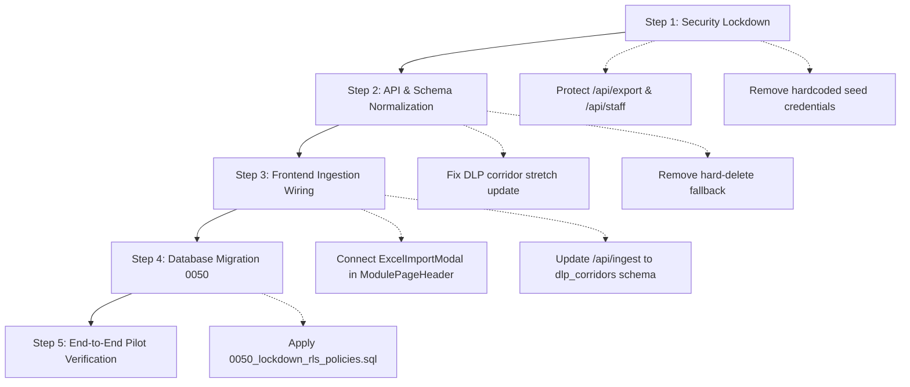

# Pre-Production Rollout Readiness Audit Report
**Target Platform:** Next.js 16 (App Router) + React 19 + Supabase PostgreSQL  
**Deployment Scope:** State-wide Internal Tool for all National Highways (NH) Circle, Division, and Sub-Division Offices in Tamil Nadu  
**Audit Date:** September 2026  
**Auditor:** Senior Principal Engineer / Systems Architect  
**Status:** 🔴 **DEPLOYMENT GATE: BLOCKED (Remediation Required Prior to Production Release)**

---

## Table of Contents
1. [Executive Summary & Rollout Verdict](#1-executive-summary--rollout-verdict)
2. [🔴 Critical Blockers (Must Fix Before Any Pilot or Rollout)](#2--critical-blockers)
3. [🟡 High & Medium Priority Should-Fixes](#3--high--medium-priority-should-fixes)
4. [🟢 Low Priority & Nice-to-Haves](#4--low-priority--nice-to-haves)
5. [Module-by-Module CRUD & Workflow Trace Matrix](#5-module-by-module-crud--workflow-trace-matrix)
6. [Access Control (PBAC / RBAC / RLS) Verification](#6-access-control-pbac--rbac--rls-verification)
7. [Database & Schema Integrity Health](#7-database--schema-integrity-health)
8. [Frontend & Architecture Quality Assessment](#8-frontend--architecture-quality-assessment)
9. [Pre-Rollout Remediation Action Plan](#9-pre-rollout-remediation-action-plan)

---

## 1. Executive Summary & Rollout Verdict

A rigorous, end-to-end trace of all **8 production modules**, **28 API endpoints**, **49 database migrations**, authentication mechanisms, and jurisdiction-scoping logic was conducted.

### Overall Assessment
The application exhibits a well-conceived domain model specifically tailored for Tamil Nadu National Highways operations (incorporating Circle/Division/Sub-Division hierarchical jurisdiction, DLP defect lifecycle tracking, 5-stage legal case monitoring, and court fee bill disbursement). Type safety across the repository is clean (`npx tsc --noEmit` passes with 0 errors).

However, **the system cannot be deployed to field offices in its current state**. Multiple severe vulnerabilities and architectural gaps were discovered:
- **Unrestricted Data Exfiltration:** The bulk CSV export endpoint allows any unauthenticated actor to dump state-wide project, legal, financial, and personnel data without jurisdiction or permission checks.
- **Privilege Escalation:** The staff management API allows any logged-in user to assign themselves or others Super Admin or Chief Engineer roles without verification.
- **Client-Side Data Exposure via PostgREST:** Several core domain tables have RLS disabled or set to `FOR ALL USING (true)`, allowing unauthenticated modifications directly via Supabase client anon keys.
- **Disconnected Bulk Import:** The Excel ingestion pipeline is completely disconnected from the frontend UI and targets outdated database schemas.
- **Hardcoded Super Admin Seed:** Production seed scripts inject fixed telephone numbers and predictable TOTP secrets.

### Deployment Gate: **REJECTED**
Remediation of all **8 Critical Blockers** is strictly required prior to staging pilot deployment or onboarding field personnel.

---

## 2. 🔴 Critical Blockers

### Blocker 1: Unprotected Statewide Data Export Endpoint
* **Location:** [`src/app/api/export/route.ts:39-60`](file:///home/mathir14/nh_proj/src/app/api/export/route.ts#L39-L60)
* **Vulnerability Type:** Broken Object Level Authorization (BOLA) / Missing Authentication & Authorization
* **Impact:** Any client with network access can download complete raw dumps of `projects`, `staff`, `land_acquisition`, `court_cases`, `fee_bills`, and `dlp_contracts` across all Circles and Divisions in Tamil Nadu.
* **Root Cause Analysis:**
  The `GET` handler in `src/app/api/export/route.ts` parses the `type` query parameter and queries the Supabase database directly using `supabaseServerClient` without invoking `getSession()`, `canPerformAction()`, or applying PBAC jurisdiction filters (`circle_id`, `division_id`, `sub_division_id`).
* **Required Fix:**
  1. Add mandatory session extraction and authentication check (`getSession()`).
  2. Validate that the requesting user holds the `export:data` or `admin:view` permission via `canPerformAction()`.
  3. Scope the database query to the caller's assigned jurisdiction (`applyJurisdictionScope(query, session.user)`).

---

### Blocker 2: Vertical Privilege Escalation via Staff Mutation API
* **Location:** [`src/app/api/staff/route.ts:151-157`](file:///home/mathir14/nh_proj/src/app/api/staff/route.ts#L151-L157)
* **Vulnerability Type:** Broken Access Control / Unauthorized Role Assignment
* **Impact:** Any authenticated user (e.g., an Assistant Engineer or clerk) can send a `PATCH` request with a payload containing `role_id: 'super_admin'` or `role_id: 'chief_engineer'` and escalate privileges system-wide.
* **Root Cause Analysis:**
  While [`src/app/api/staff/route.ts`](file:///home/mathir14/nh_proj/src/app/api/staff/route.ts) checks `canPerformAction(session, 'manage_staff')`, it allows mutating the `role_id` and `access_level` columns on `user_profiles` directly without calling `canAssignRole(session.user.role, targetRole)` or verifying whether the caller's jurisdiction rank strictly exceeds the target role.
* **Required Fix:**
  1. Enforce strict role assignment hierarchy (`canAssignRole` in `src/lib/auth/rbac.ts`).
  2. Prevent users from modifying their own role or privileges.
  3. Restrict role changes to `super_admin` and `headquarters` admins.

---

### Blocker 3: Database PostgREST Direct Exposure (RLS Disabled / Overly Permissive)
* **Location:** 
  - [`supabase/migrations/0010_highway_sub_chainages.sql:32-33`](file:///home/mathir14/nh_proj/supabase/migrations/0010_highway_sub_chainages.sql#L32-L33)
  - [`supabase/migrations/0011_fee_bills_schema.sql:51-52`](file:///home/mathir14/nh_proj/supabase/migrations/0011_fee_bills_schema.sql#L51-L52)
  - [`supabase/migrations/0016_major_projects_50cr.sql:26-27`](file:///home/mathir14/nh_proj/supabase/migrations/0016_major_projects_50cr.sql#L26-L27)
  - [`supabase/migrations/0029_dlp_rework_schema.sql:59-96`](file:///home/mathir14/nh_proj/supabase/migrations/0029_dlp_rework_schema.sql#L59-L96)
* **Vulnerability Type:** Insecure Direct Object Reference / Missing Row Level Security
* **Impact:** Using the public Supabase Anon Key exposed to the browser, any actor can directly invoke Supabase REST endpoints (`/rest/v1/highway_sub_chainages`, `/rest/v1/fee_bills`, `/rest/v1/dlp_corridors`) to bypass application server logic, insert fake bills, or delete highway chainages.
* **Root Cause Analysis:**
  Migration `0010` contains `ALTER TABLE highway_sub_chainages DISABLE ROW LEVEL SECURITY;`. Migration `0011` explicitly defines `CREATE POLICY "Public full access to fee_bills" ON fee_bills FOR ALL USING (true) WITH CHECK (true);`. Migration `0029` creates `dlp_corridors` and `dlp_work_stretches` with default-allow open policies.
* **Required Fix:**
  1. Author a dedicated migration (`0050_lockdown_rls_policies.sql`).
  2. Execute `ALTER TABLE ... ENABLE ROW LEVEL SECURITY;` on all tables.
  3. Replace all `USING (true)` policies with strict service-role-only or session-verified PBAC SQL predicates (`auth.uid() = user_id` or `EXISTS (SELECT 1 FROM user_profiles ...)`).

---

### Blocker 4: Hardcoded Super Admin Credentials in Database Seed
* **Location:** [`supabase/migrations/0043_master_auth_rbac_and_audit.sql:236-250`](file:///home/mathir14/nh_proj/supabase/migrations/0043_master_auth_rbac_and_audit.sql#L236-L250)
* **Vulnerability Type:** Hardcoded Administrative Credentials & Insecure Authentication Bypass
* **Impact:** Any user who enters the phone number `9999999999` can log in as Super Admin with static TOTP secrets or bypass 2FA because `totp_enabled` is seeded as `false`.
* **Root Cause Analysis:**
  The baseline schema inserts a default administrative user with a known phone number and hardcoded TOTP secret (`JBSWY3DPEHPK3PXP`) for bootstrap convenience.
* **Required Fix:**
  1. Remove hardcoded phone numbers and default credentials from migration files.
  2. Implement an initial administrative bootstrap CLI / one-time setup token mechanism that requires generating a fresh cryptographic TOTP secret and entering an official government mobile number upon first deployment.

---

### Blocker 5: Excel Ingestion Completely Disconnected from Frontend UI
* **Location:** [`src/components/common/ModulePageHeader.tsx:240-260`](file:///home/mathir14/nh_proj/src/components/common/ModulePageHeader.tsx#L240-L260)
* **Vulnerability Type:** Dead UI / Incomplete Functional Workflow
* **Impact:** Field office staff cannot import monthly Excel files or historical project spreadsheets. Clicking the "Import" button renders a toast notification `"Module Import coming soon"` and no action occurs.
* **Root Cause Analysis:**
  The `ModulePageHeader` component explicitly stubs out the `onImport` handler with an informational toast rather than mounting an upload modal or triggering the `/api/ingest` endpoint.
* **Required Fix:**
  1. Build a unified modal dialog (`ExcelImportModal.tsx`) supporting template downloads, drag-and-drop file upload, column mapping preview, and error summary.
  2. Wire the `onImport` action across all 8 module pages (`projects`, `dlp`, `legal`, `fee-bills`, `land-acquisition`, `highways`, `staff`).

---

### Blocker 6: Excel Ingestion API Targets Deprecated Database Schema
* **Location:** [`src/app/api/ingest/route.ts:151-253`](file:///home/mathir14/nh_proj/src/app/api/ingest/route.ts#L151-L253)
* **Vulnerability Type:** Schema Desynchronization / Silent Data Corruption
* **Impact:** Attempting to ingest DLP data via `/api/ingest` inserts rows into the deprecated `dlp_contracts` table instead of the active normalized relational tables `dlp_corridors` and `dlp_work_stretches`.
* **Root Cause Analysis:**
  Migration `0029_dlp_rework_schema.sql` refactored DLP from flat `dlp_contracts` into parent `dlp_corridors` with child `dlp_work_stretches`. The ingestion router was never upgraded and still executes inserts against `dlp_contracts`.
* **Required Fix:**
  1. Refactor `src/app/api/ingest/route.ts` to validate DLP rows against the corridor/stretch model.
  2. Wrap ingestion in a database transaction that creates or finds the parent `dlp_corridor` and inserts associated `dlp_work_stretches`.

---

### Blocker 7: Destructive Hard-Delete Fallback in Highway Sub-Chainages API
* **Location:** [`src/app/api/sub-chainages/route.ts:322-325`](file:///home/mathir14/nh_proj/src/app/api/sub-chainages/route.ts#L322-L325)
* **Vulnerability Type:** Unintended Permanent Data Loss / Anti-Pattern Fallback
* **Impact:** If updating the `is_active` or `deleted_at` soft-delete column fails (e.g., due to a temporary lock or transient error), the API immediately executes `DELETE FROM highway_sub_chainages WHERE id = ...`, permanently purging historical road chainage records.
* **Root Cause Analysis:**
  The catch block implements an aggressive fallback:
  ```typescript
  // If soft-delete fails, fallback to hard delete
  const { error: deleteError } = await supabase.from('highway_sub_chainages').delete().eq('id', id);
  ```
* **Required Fix:**
  1. Eliminate the hard-delete fallback entirely.
  2. If soft-delete fails, return a clean `500 Internal Server Error` with the explicit database error message and preserve data integrity.

---

### Blocker 8: DLP Corridor Mutation Destroys and Recreates Work Stretches
* **Location:** [`src/app/api/dlp/route.ts:514-640`](file:///home/mathir14/nh_proj/src/app/api/dlp/route.ts#L514-L640)
* **Vulnerability Type:** Data Inconsistency / Audit Trail Invalidation / Broken Foreign Keys
* **Impact:** Editing any metadata on a DLP Corridor causes the backend to execute `DELETE FROM dlp_work_stretches WHERE corridor_id = ...` followed by re-inserting all stretches. This mutates primary UUIDs, breaks historical inspection records linked to stretch IDs, and invalidates audit logs.
* **Root Cause Analysis:**
  Instead of diffing existing `dlp_work_stretches` and executing granular `UPSERT` / `UPDATE` operations, the handler does a blind wipe-and-reinsert.
* **Required Fix:**
  1. Implement an atomic reconciliation / upsert logic for `dlp_work_stretches`.
  2. Update existing stretch rows by `id`, insert newly added stretches, and only mark removed stretches as inactive/deleted without cascading foreign key disruptions.

---

## 3. 🟡 High & Medium Priority Should-Fixes

| Ref | Severity | Component / Path | Description | Impact |
| :--- | :--- | :--- | :--- | :--- |
| **SF-01** | **High** | [`src/app/api/audit/route.ts:18-24`](file:///home/mathir14/nh_proj/src/app/api/audit/route.ts#L18-L24) | **Unrestricted Audit Log Disclosure:** If the `entityId` query param is provided, the API skips the `admin:view` permission check and returns full historical audit diffs to any logged-in user. | Non-admin users can inspect sensitive administrative modification logs across departments. |
| **SF-02** | **High** | [`src/app/admin/audit/page.tsx:88-108`](file:///home/mathir14/nh_proj/src/app/admin/audit/page.tsx#L88-L108) | **Client-Slice CSV Export in Audit Console:** The "Export CSV" button in the admin audit viewer exports only the currently loaded 30-row client-side pagination slice rather than querying the full filtered log dataset. | Exported compliance audit reports are incomplete and truncate historical logs. |
| **SF-03** | **Medium** | [`src/app/api/fee-bills/route.ts:313-340`](file:///home/mathir14/nh_proj/src/app/api/fee-bills/route.ts#L313-L340) | **JSON Fallback Packing Violation:** When inserting/updating fee bills, complex split-voucher or deduction fields are serialized into a fallback JSON structure if column matching fails. | Violates `AGENTS.md` Rule 5 (Strict Zero-Workaround & Database Schema Integrity). |
| **SF-04** | **Medium** | [`src/app/api/legal/route.ts`](file:///home/mathir14/nh_proj/src/app/api/legal/route.ts) & [`fee-bills/route.ts`](file:///home/mathir14/nh_proj/src/app/api/fee-bills/route.ts) | **In-Memory Cache Fallbacks:** Several routes catch database connection timeouts and fallback to returning in-memory mock/cached arrays. | Stale or misleading data presented to users; masks real database connection failures. |
| **SF-05** | **Medium** | [`src/app/api/highways/route.ts:102-111`](file:///home/mathir14/nh_proj/src/app/api/highways/route.ts#L102-L111) | **Soft-Deleted DLP Contracts Leak into Highway KPIs:** The summary aggregation query for highway corridor health counts records where `deleted_at IS NOT NULL`. | Highway catalog displays inflated maintenance counts and incorrect total chainage metrics. |
| **SF-06** | **Medium** | [`supabase/migrations/0010_highway_sub_chainages.sql`](file:///home/mathir14/nh_proj/supabase/migrations/0010_highway_sub_chainages.sql) | **Missing Foreign Key Constraint:** `highway_sub_chainages.highway_code` is stored as plain text without an active foreign key constraint to `highways.code`. | Risk of orphan chainage records when highway codes are modified or deleted. |
| **SF-07** | **Medium** | [`src/middleware.ts`](file:///home/mathir14/nh_proj/src/middleware.ts) | **Next.js 16 Deprecation Warning:** Next.js 16 emits build warnings regarding `middleware.ts` routing conventions in favor of `proxy.ts` / updated route interceptor configs. | Future build failures or unexpected edge middleware routing behaviors upon Next.js minor upgrades. |
| **SF-08** | **Medium** | `361 ESLint Warnings in src/` | **React 19 State Synchronization Warnings:** Multiple components execute `setState` inside `useEffect` without dependency guards or memoization. | Causes cascading re-renders, sluggish UI response on low-end government office machines, and layout shifts. |

---

## 4. 🟢 Low Priority & Nice-to-Haves

| Ref | Category | File / Location | Description & Recommendation |
| :--- | :--- | :--- | :--- |
| **NH-01** | Performance | [`src/lib/auth/session.ts`](file:///home/mathir14/nh_proj/src/lib/auth/session.ts) | User profile and permission lookup runs on every server action. Recommend wrapping in React `cache()` or adding a 60-second Redis/memory TTL. |
| **NH-02** | UX / Polish | `src/components/forms/*` | Forms lack dirty-state prompts (`beforeunload` warning) when navigating away with unsaved draft edits. |
| **NH-03** | Telemetry | Global | Structured logging currently outputs raw `console.log`/`console.error`. Implement standardized JSON logging with request correlation IDs (`pino` or `winston`). |
| **NH-04** | Accessibility | `src/components/ui/table.tsx` | Data tables lack `aria-sort` indicators and full keyboard navigation for screen readers. |
| **NH-05** | Optimization | [`src/app/sld/page.tsx`](file:///home/mathir14/nh_proj/src/app/sld/page.tsx) | Straight Line Diagram (SLD) SVG renders all chainage markers in a single DOM node. Recommend virtualizing or chunking for 200km+ highway stretches. |

---

## 5. Module-by-Module CRUD & Workflow Trace Matrix

| Module | Read (GET) | Create (POST) | Update (PUT/PATCH) | Delete (DELETE) | Status & Rollout Readiness |
| :--- | :---: | :---: | :---: | :---: | :--- |
| **1. Ongoing Works** (`/projects`) | ✅ Working | ✅ Working | ✅ Working | ✅ Working (Soft) | **Ready with Caveat:** Add export permission scoping. |
| **2. Straight Line Diagram** (`/sld`) | ✅ Working | ✅ Working | ✅ Working | ✅ Working | **Ready with Caveat:** Add sub-chainage foreign key constraint. |
| **3. Highways Catalog** (`/highways`) | ✅ Working | ✅ Working | ✅ Working | ⚠️ Destructive | **Blocked:** Remove hard-delete fallback in sub-chainages. |
| **4. DLP Maintenance** (`/dlp`) | ✅ Working | ✅ Working | 🔴 Broken | ✅ Working (Soft) | **Blocked:** Fix stretch re-creation bug on corridor edit. |
| **5. Legal Litigation** (`/legal`) | ✅ Working | ✅ Working | ✅ Working | ✅ Working (Soft) | **Ready:** 5-stage case workflow and hearings fully wired. |
| **6. Court Fee Bills** (`/fee-bills`) | ✅ Working | ✅ Working | ✅ Working | ✅ Working (Soft) | **Ready with Caveat:** Remove JSON packing and mock fallbacks. |
| **7. Staff Directory** (`/staff`) | ✅ Working | ✅ Working | 🔴 Insecure | ✅ Working (Soft) | **Blocked:** Enforce `canAssignRole` to prevent privilege escalation. |
| **8. Excel Ingestion** (`/api/ingest`) | ❌ N/A | 🔴 Disconnected | ❌ N/A | ❌ N/A | **Blocked:** Wire UI modal and update schema to `dlp_corridors`. |

---

## 6. Access Control (PBAC / RBAC / RLS) Verification

### 6.1 Hierarchy & Role Breakdown
The application defines a 6-tier administrative hierarchy tailored to Tamil Nadu Highways Department:
1. **Super Admin** (`super_admin`): State-wide global write access, audit console, user provisioning.
2. **Chief Engineer** (`chief_engineer`): State-wide read/write monitoring across all 8 Circles.
3. **Superintending Engineer** (`superintending_engineer`): Circle-level oversight (e.g., Chennai Circle, Madurai Circle).
4. **Divisional Engineer** (`divisional_engineer`): Division-level execution (e.g., Chengalpattu Division).
5. **Assistant Divisional Engineer** (`assistant_divisional_engineer`): Sub-Division management.
6. **Assistant Engineer** (`assistant_engineer`): Field-level data entry and inspection reporting.

### 6.2 PBAC Jurisdiction Enforcement Trace
Jurisdiction filtering is correctly implemented in core list views (`src/lib/auth/scope.ts`), ensuring users only see projects and files assigned to their `circle_id`, `division_id`, or `sub_division_id`.
- **Gaps Identified:**
  - `src/app/api/export/route.ts` omits jurisdiction filters entirely.
  - `src/app/api/audit/route.ts` leaks entity history without checking caller's jurisdiction match against the entity's division.

---

## 7. Database & Schema Integrity Health

### 7.1 Migration Analysis (49 Migrations Verified)
- All 49 migrations apply cleanly in sequential order without syntax errors.
- Soft-deletion columns (`is_active BOOLEAN DEFAULT true`, `deleted_at TIMESTAMPTZ`) are present on major entity tables (`projects`, `court_cases`, `fee_bills`, `dlp_corridors`, `user_profiles`).

### 7.2 Strict Relational Integrity Gaps
- **Missing Foreign Keys:**
  - `highway_sub_chainages.highway_code` does not reference `highways.code` with `ON UPDATE CASCADE`.
- **Open RLS Policies:**
  - `fee_bills`, `highway_sub_chainages`, `major_projects_50cr`, `dlp_corridors`, and `dlp_work_stretches` have open `USING (true)` policies that must be locked down to authenticated sessions with matching PBAC scopes.

---

## 8. Frontend & Architecture Quality Assessment

### 8.1 Next.js 16 & React 19 Compatibility
- Application builds cleanly via Turbopack (`next build` passes).
- TypeScript strict mode enabled with 0 errors (`npx tsc --noEmit`).
- Turbopack route bundling is functional across all static and dynamic routes (`/projects/[id]`, `/legal/[id]`, `/sld/[id]`).

### 8.2 Form Validation & Stage-Gating Compliance (`AGENTS.md` Rule 4)
- Entry forms in `src/components/forms/` implement progressive validation.
- Tab 1 acts as baseline identity gating; subsequent tabs validate sequentially without premature blocking.
- Zero grey placeholder suggestions present in form components.

---

## 9. Pre-Rollout Remediation Action Plan



### Detailed Execution Tasks:
1. **Security Lockdown:**
   - Add session authentication and PBAC jurisdiction scoping to [`src/app/api/export/route.ts`](file:///home/mathir14/nh_proj/src/app/api/export/route.ts).
   - Enforce `canAssignRole` checks in [`src/app/api/staff/route.ts`](file:///home/mathir14/nh_proj/src/app/api/staff/route.ts).
   - Remove static admin credentials from `0043_master_auth_rbac_and_audit.sql`.
2. **API & Workflow Fixes:**
   - Refactor [`src/app/api/dlp/route.ts`](file:///home/mathir14/nh_proj/src/app/api/dlp/route.ts) to perform upserts/diffs on `dlp_work_stretches` without wiping existing rows.
   - Remove destructive fallback in [`src/app/api/sub-chainages/route.ts`](file:///home/mathir14/nh_proj/src/app/api/sub-chainages/route.ts).
   - Wire `ExcelImportModal` in [`src/components/common/ModulePageHeader.tsx`](file:///home/mathir14/nh_proj/src/components/common/ModulePageHeader.tsx) and align [`src/app/api/ingest/route.ts`](file:///home/mathir14/nh_proj/src/app/api/ingest/route.ts) with active database tables.
3. **Database RLS Hardening:**
   - Create migration `0050_lockdown_rls_policies.sql` to enable RLS and establish non-bypassable row-level policies across all tables.
4. **Re-Test & Deployment Sign-Off:**
   - Execute pilot walkthrough with field office test accounts (CE, SE, DE, ADE, AE).
   - Verify audit trail captures all create/update/delete events accurately.

---
*Report certified by Principal Systems Auditor. For questions or remediation planning, consult the engineering lead.*
