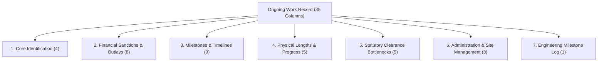
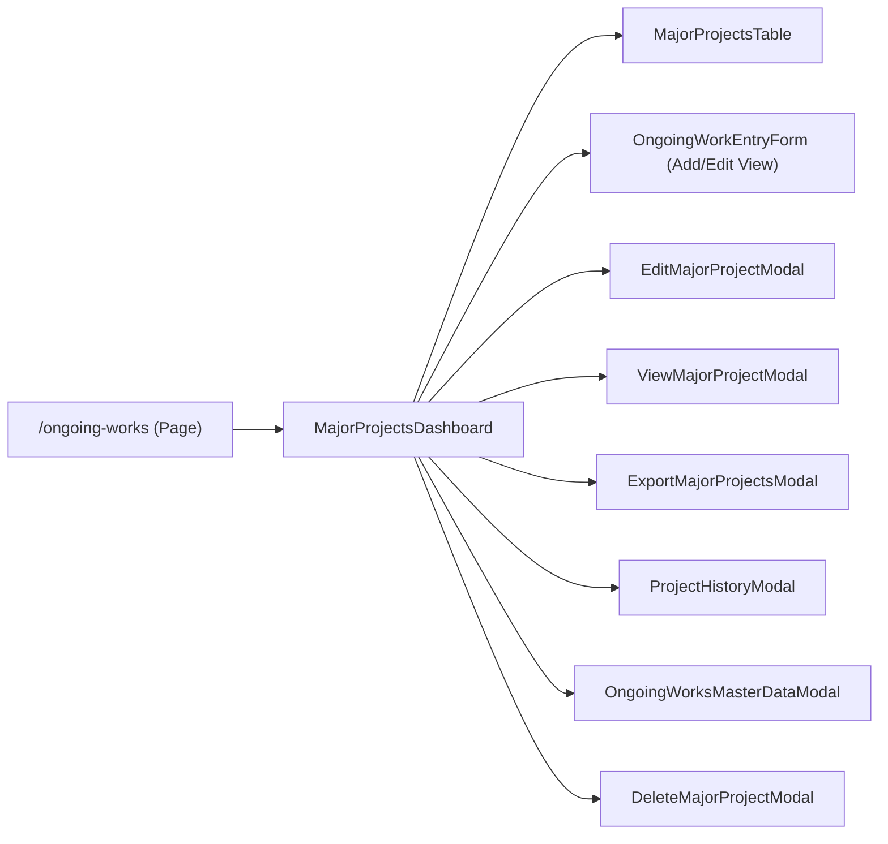

# Ongoing Works (Major Projects) Module — Complete System Specification & Technical Documentation

**Tamil Nadu National Highways Department Management Portal**  
*Document Version: 2.0.0 | Updated: August 2026*

---

## 1. Executive Summary & Module Purpose

The **Ongoing Works (Major Projects)** module is a departmental project monitoring, milestone tracking, and financial governance system designed for high-value highway infrastructure projects across Tamil Nadu.

The module provides:
- **35-Column Departmental Layout**: Complete alignment with official MoRTH and State NH review formats.
- **Triple Progress Metrics**: Real-time visualization of Physical Progress (%), Financial Progress against Total Project Cost (%), and Financial Burn against Contract Award Value (%).
- **Freeze-When-Filled Data Integrity**: Immutability for baseline sanctioned parameters once entered, while preserving editability for previously blank cells.
- **Dynamic Serial Sequencing**: Automatic client and export index generation without manual S.No data-entry overhead.
- **Clearance Bottleneck Isolation**: Clean separation between the 5 dedicated statutory clearance registers (Land, Forest, Utility, Railways, Others) and the multi-paragraph engineering milestone log (Column 27).
- **Custom Interactive Exporter**: Multi-format (`.xlsx`, `.csv`) customizable export engine with row selection, category filters, and column customization.
- **Audit Snapshots**: Automatic versioned history for every modification.

---

## 2. The 35-Column Departmental Data Model

The data model contains **35 distinct columns** grouped into 7 functional modules:

### Complete Field Specification Table

| # | Database Key | Departmental Label / Column Title | Data Type | Freeze Rule | Default / Computation | UI Module (Entry Form) | UI Tab (Modal) |
|---|---|---|---|---|---|---|---|
| **1** | `s_no` | Serial Number | `INTEGER` | Dynamic | Auto-generated (`idx + 1`) | Dynamic Index | Dynamic Index |
| **2** | `division` | Administrative Division | `VARCHAR(100)` | Freeze-when-filled | Master division select | Module 1 | Tab 1 |
| **3** | `scheme` | Scheme / Funding Program | `VARCHAR(150)` | Freeze-when-filled | Master scheme select | Module 1 | Tab 1 |
| **4** | `name_of_work` | Official Sanctioned Name of Work | `TEXT` | Freeze-when-filled | Required string | Module 1 | Tab 1 |
| **5** | `pmis_id` | PMIS / OCMS / PMG Work ID | `VARCHAR(100)` | Freeze-when-filled | Optional string | Module 5 | Tab 2 |
| **6** | `old_new_nh` | Old NH / New NH Number | `VARCHAR(100)` | Freeze-when-filled | Optional string | Module 5 | Tab 2 |
| **7** | `length_km` | Sanctioned Length (km) | `NUMERIC(10,3)` | Freeze-when-filled | Numeric (3 decimals) | Module 5 | Tab 2 |
| **8** | `job_no` | MoRTH Job Number | `VARCHAR(100)` | Freeze-when-filled | Standard job code | Module 5 | Tab 2 |
| **9** | `sanction_date` | Date of Sanction | `VARCHAR(50)` | Freeze-when-filled | Indian date string | Module 5 | Tab 2 |
| **10** | `loa_date` | Date of Issue of LOA | `VARCHAR(50)` | Freeze-when-filled | Date picker / string | Module 5 | Tab 2 |
| **11** | `agreement_date` | Date of Contract Agreement | `VARCHAR(50)` | Freeze-when-filled | Date picker / string | Module 5 | Tab 2 |
| **12** | `contract_value_cr` | Contract Award Value (₹ Cr) | `NUMERIC(12,2)` | Freeze-when-filled | Numeric in Crores | Module 2 | Tab 4 |
| **13** | `site_handover_date` | Date of Site Handover to Agency | `VARCHAR(50)` | Freeze-when-filled | Date picker / string | Module 5 | Tab 2 |
| **14** | `appointed_date` | Appointed Date / Date of Start | `VARCHAR(50)` | Freeze-when-filled | Date picker / string | Module 5 | Tab 2 |
| **15** | `scheduled_completion_date` | Scheduled Date of Completion | `VARCHAR(50)` | Freeze-when-filled | Baseline completion date | Module 3 & 5 | Tab 2 |
| **16** | `project_cost_cr` | Original Sanction Cost / TPC (₹ Cr) | `NUMERIC(12,2)` | Freeze-when-filled | Numeric in Crores | Module 2 | Tab 1 & Tab 4 |
| **17** | `revised_cost_cr` | Revised / Anticipated Cost (₹ Cr) | `NUMERIC(12,2)` | Editable | Optional; triggers RCE auto-calc | Module 2 | Tab 4 |
| **18** | `cost_increase_rce_cr` | Cost Increase due to RCE (₹ Cr) | `NUMERIC(12,2)` | Editable | `revised_cost_cr - project_cost_cr` | Module 2 | Tab 4 |
| **19** | `expenditure_prior_cr` | Expenditure upto Prior FY (₹ Cr) | `NUMERIC(12,2)` | Editable | Auto-sums to cumulative | Module 2 | Tab 4 |
| **20** | `expenditure_current_fy_cr` | Expenditure Current FY (₹ Cr) | `NUMERIC(12,2)` | Editable | Auto-sums to cumulative | Module 2 | Tab 4 |
| **21** | `cumm_financial_expenditure_cr`| Cumulative Financial Expenditure (₹ Cr) | `NUMERIC(12,2)` | Editable | `prior + current_fy` | Module 2 | Tab 4 |
| **22** | `contract_cum_expenditure_cr` | Cumulative Contract Expenditure (₹ Cr) | `NUMERIC(12,2)` | Editable | Contract burn outlay | Module 2 | Tab 4 |
| **23** | `completed_length_prior_km` | Completed Length Prior FY (km) | `NUMERIC(10,3)` | Editable | Auto-sums to total length | Module 3 | Tab 3 |
| **24** | `completed_length_current_fy_km`| Completed Length Current FY (km) | `NUMERIC(10,3)` | Editable | Auto-sums to total length | Module 3 | Tab 3 |
| **25** | `total_completed_length_km` | Total Completed Length (km) | `NUMERIC(10,3)` | Editable | `prior_km + current_fy_km` | Module 3 | Tab 3 |
| **26** | `progress_percent` | Overall Physical Progress (%) | `NUMERIC(5,2)` | Monotonic | 0.0 to 100.0 | Module 3 | Tab 1 & Tab 3 |
| **27** | `work_stage` | Work Execution Stage | `VARCHAR(50)` | Editable | `IN_PROGRESS` / `TENDER_STAGE` / `COMPLETED` | Module 3 | Tab 1 |
| **28** | `likely_completion_date` | Likely Date of Completion | `VARCHAR(50)` | Editable | Target completion string | Module 3 | Tab 5 |
| **29** | `probable_completion_date` | Probable / Actual Completion Date | `VARCHAR(50)` | Editable | Target completion string | Module 3 | Tab 1 & Tab 3 |
| **30** | `time_overrun_years` | Time Overrun in Years | `NUMERIC(6,2)` | Editable / Auto | Dynamically calculated from baseline | Module 3 | Tab 5 |
| **31** | `eot_granted_till` | EOT (Extension of Time) Granted Till | `TEXT` | Editable | Approval date / letter ref | Module 3 | Tab 5 |
| **32** | `eot_proposal_agency` | Further EOT Proposal with Agency | `TEXT` | Editable | Proposal status / remarks | Module 3 | Tab 5 |
| **33** | `cos_details` | Change of Scope (COS) Details | `TEXT` | Editable | Scope revision notes | Module 3 | Tab 5 |
| **34** | `de_name_phone` | Divisional Engineer Name & Phone | `VARCHAR(150)` | Editable | Contact details | Module 5 | Tab 7 |
| **35** | `contractor_name` | Executing Contractor / Agency | `VARCHAR(255)` | Editable | Contractor / JV name | Module 5 | Tab 7 |
| **36** | `updated_division_date` | Updated Division & Timestamp Ref | `VARCHAR(150)` | Editable | e.g. `Vellore 15.03.2026` | Module 5 | Tab 7 |
| **37** | `issue_land` | Land Acquisition Bottlenecks | `TEXT` | Editable | 3(A), 3(D), 3(G) LA & stays | Module 4 | Tab 6 |
| **38** | `issue_forest` | Forest & Environmental Clearances | `TEXT` | Editable | Stage-I, Stage-II, wildlife | Module 4 | Tab 6 |
| **39** | `issue_utility` | Utility Relocation Issues | `TEXT` | Editable | TANGEDCO, TWAD, OFC lines | Module 4 | Tab 6 |
| **40** | `issue_railways` | Railway Approvals & Clearances | `TEXT` | Editable | GAD, ROB/RUB, CRS permissions | Module 4 | Tab 6 |
| **41** | `issue_others` | General Bottlenecks & Litigations | `TEXT` | Editable | Court stays, slow progress | Module 4 | Tab 6 |
| **42** | `detailed_stage_status` | Granular Milestone Log (Col 27) | `TEXT` | Editable | Structural log, piers/slabs | Module 6 | Tab 8 |
| **43** | `progress_remarks` | Physical Progress Remarks | `TEXT` | Editable | Execution milestone summary | Module 3 | Tab 3 |
| **44** | `stage_remarks` | Tender / Pre-Work Remarks | `TEXT` | Editable | Estimate scrutiny & DPR notes | Module 3 | Tab 1 |

*(Note: Total database fields = 44 including stage/remarks distinctions and system timestamps, mapped cleanly to the 35 departmental export/import columns).*

---

## 3. Core Business Rules & Execution Logic

### 3.1. Freeze-When-Filled Rule (Write-Once Baseline)

> [!IMPORTANT]
> Standard users cannot edit baseline project parameters once they contain a valid value. However, if a baseline field was left blank upon initial creation, it remains unlocked until populated.

- **Lock Condition**:
  $$\text{Locked} \iff \text{initialData}[\text{field}] \neq \text{null} \land \text{initialData}[\text{field}] \neq \text{undefined} \land \text{initialData}[\text{field}] \neq \text{""}$$
- **Protected Columns**:
  - `name_of_work`, `division`, `scheme`
  - `project_cost_cr`, `contract_value_cr`
  - `pmis_id`, `old_new_nh`, `length_km`, `job_no`, `sanction_date`
  - `loa_date`, `agreement_date`, `site_handover_date`, `appointed_date`, `scheduled_completion_date`
- **Admin Privilege**: Administrator sessions can override and modify frozen parameters.

---

### 3.2. Dynamic Sequential S.No

- **User Entry Exemption**: `S.No` is omitted from manual input forms to prevent indexing collisions.
- **Live Client Sequence**: In [`MajorProjectsTable.tsx`](file:///home/mathir14/nh_proj/src/components/major-projects/MajorProjectsTable.tsx), S.No is rendered as `idx + 1`, adapting dynamically to filtered, searched, or sorted views.
- **Export Consistency**: In [`majorProjectsExportGenerator.ts`](file:///home/mathir14/nh_proj/src/lib/export/majorProjectsExportGenerator.ts), S.No is generated as `1, 2, 3, \dots, N` corresponding to the export sequence.

---

### 3.3. Manual Work Completion Routing

- **Rule**: Physical progress reaching $100\%$ does **not** automatically migrate a project to the completed register. Completion requires formal issuance of the Taking-Over Certificate (TOC) and administrative completion status.
- **Workflow**:
  - `work_stage === 'IN_PROGRESS'`: Default execution state.
  - `work_stage === 'TENDER_STAGE'`: Pre-construction and bidding stage.
  - `work_stage === 'COMPLETED'`: Project is manually archived into the Completed Works register.

---

### 3.4. Triple Progress Metrics

Every project calculates and tracks three distinct progress dimensions:

1. **Physical Progress ($\%$)**:
   $$\text{Phy \%} = \text{progress\_percent}$$
2. **Financial Progress against Total Cost ($\%$)**:
   $$\text{Fin \%} = \min\left(100, \left(\frac{\text{cumm\_financial\_expenditure\_cr}}{\text{revised\_cost\_cr} \lor \text{project\_cost\_cr}}\right) \times 100\right)$$
3. **Contract Value Burn Progress ($\%$)**:
   $$\text{Cont \%} = \min\left(100, \left(\frac{\text{contract\_cum\_expenditure\_cr}}{\text{contract\_value\_cr}}\right) \times 100\right)$$

---

### 3.5. Monotonic Physical Progress Constraint

- For non-admin user edits, physical progress cannot decrease:
  $$\text{progress\_percent}_{\text{new}} \ge \text{progress\_percent}_{\text{previous}}$$

---

### 3.6. Dynamic Delay & Overrun Analysis

- **Delay Computation**:
  $$\text{Delay} = \text{Probable / Likely Completion Date} - \text{Scheduled Baseline Completion Date}$$
- If delay $> 0$, the system displays an alert badge (`+X.X Yrs Delay`) and updates `time_overrun_years`.

---

## 4. UI Architecture & Component Inventory

### Component Details

1. [`MajorProjectsDashboard.tsx`](file:///home/mathir14/nh_proj/src/components/major-projects/MajorProjectsDashboard.tsx):
   - Executive KPI header (Total Works, Execution, Pre-Work, Completed, Overruns, $\ge ₹50\text{ Cr}$).
   - Streamlined filter bar: Full-text search, $\ge ₹50\text{ Cr}$ toggle, Division selector, Delay range (years), Progress range ($\%$).
   - View mode switcher (`LIST` vs `FORM`).

2. [`MajorProjectsTable.tsx`](file:///home/mathir14/nh_proj/src/components/major-projects/MajorProjectsTable.tsx):
   - Checkbox selection & floating action bar.
   - Triple progress indicators (Phy, Fin, Cont).
   - Dynamic status badges and calculated delay counters.

3. [`OngoingWorkEntryForm.tsx`](file:///home/mathir14/nh_proj/src/components/major-projects/OngoingWorkEntryForm.tsx):
   - **Module 1 (Blue)**: Administrative Identification.
   - **Module 2 (Emerald)**: Financial Sanctions, Contract Outlays & Expenditures (with live Fin $\%$ and Cont $\%$ badges).
   - **Module 3 (Indigo)**: Physical Milestones, Length Progress & Targets (with auto-summed lengths).
   - **Module 4 (Red)**: Clearance Bottlenecks (5 isolated statutory fields).
   - **Module 5 (Slate)**: Contract Milestones, Identifiers & Key Personnel.
   - **Module 6 (Amber)**: Granular Engineering Milestone Log (Col 27).

4. [`EditMajorProjectModal.tsx`](file:///home/mathir14/nh_proj/src/components/major-projects/EditMajorProjectModal.tsx):
   - 8 tabbed interface covering all 35 columns.
   - Freeze-when-filled input locks with lock icons.

5. [`ViewMajorProjectModal.tsx`](file:///home/mathir14/nh_proj/src/components/major-projects/ViewMajorProjectModal.tsx):
   - 5-metric overview ribbon.
   - 7 structured sections presenting complete project intelligence.

6. [`ExportMajorProjectsModal.tsx`](file:///home/mathir14/nh_proj/src/components/major-projects/ExportMajorProjectsModal.tsx) & [`majorProjectsExportGenerator.ts`](file:///home/mathir14/nh_proj/src/lib/export/majorProjectsExportGenerator.ts):
   - Custom column selector (35 columns across 7 categories).
   - Scope: All rows, filtered rows, or selected checkboxes.
   - Output: Formatted `.xlsx` (auto-fit columns, styled header, frozen pane) and `.csv`.

---

## 5. API Endpoints & Database Architecture

### REST Endpoints

- `GET /api/major-projects`: List projects with filters (`includeDeleted`, `completionFilter`, `division`, `stage`).
- `POST /api/major-projects`: Upsert project record with automatic snapshot generation and freeze validation.
- `DELETE /api/major-projects`: Soft delete (`delete_status = 'DELETED'`).
- `GET /api/major-projects/snapshots?projectId=<id>`: Fetch historical snapshot audit timeline.
- `GET /api/ongoing-works/master-data`: Fetch master divisions and schemes.
- `POST /api/ingest`: Bulk ingestion from Excel sheets with 35-column automatic mapping.

### Database Tables (Supabase / PostgreSQL)

1. **`major_projects_50cr`** (Primary Table):
   - Primary key: `id` (`UUID` / `TEXT`).
   - 35 departmental data fields.
   - Audit columns: `delete_status`, `created_at`, `updated_at`.

2. **`major_project_snapshots`** (Audit Trail):
   - Primary key: `id` (`UUID`).
   - Foreign key: `project_id`.
   - Action source: `EXCEL_UPLOAD`, `MANUAL_ADD`, `MANUAL_EDIT`, `INLINE_EDIT`.
   - Snapshot payload: `full_snapshot` (`JSONB`).

---

## 6. Verification & Build Health

- **TypeScript Typecheck**: Zero errors (`npx tsc --noEmit`).
- **Next.js Production Build**: Clean optimization and tree shaking (`npm run build`).
- **Repository Alignment**: Fully synced with `origin main`.
